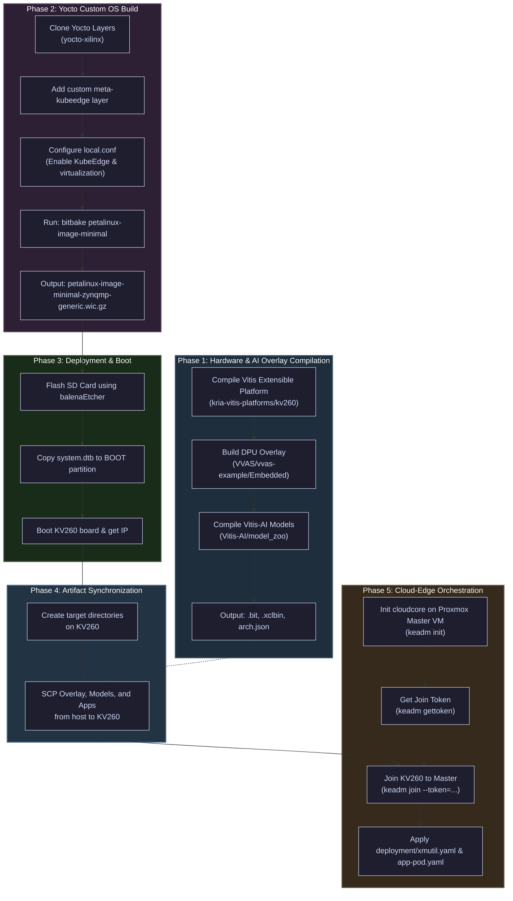
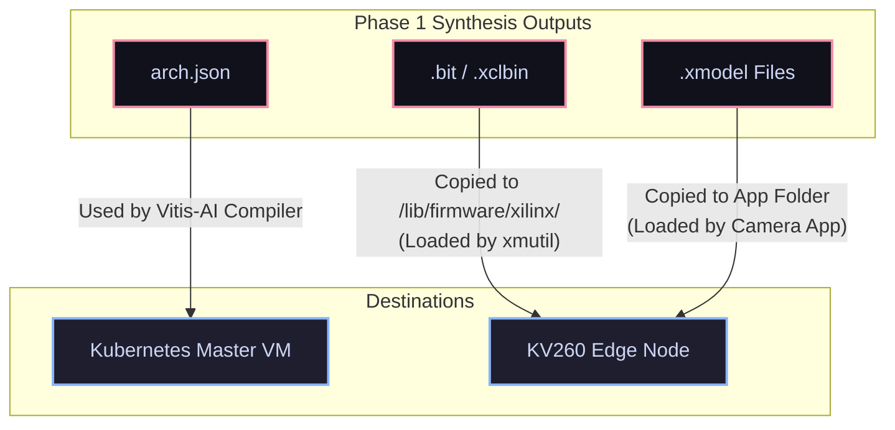

# KV260 Workspace

> Personal workspace documenting the full development, deployment, and orchestration pipeline for the **Xilinx Kria KV260** edge AI platform — covering Yocto-based Linux image builds, hardware overlay configuration, AI model compilation, Kubernetes/KubeEdge cluster setup, and remote management tooling.

**Maintainer**: Steven Pratama — [@syvesdh](https://github.com/syvesdh)

**Last Updated**: June 2026

---

#### Directory Structure and Submodule Analysis

Below is a detailed breakdown of the directories within the `smartapp-modified` workspace and their respective functions:

*   **[`kv260-smartapp-cli`](smartapp-modified/kv260-smartapp-cli/) (Go Command Line Interface)**
    *   **Purpose**: Contains the source code for the custom `ninoctl` command-line utility. 
    *   **Key Files**:
        *   `src/main.go`: Entry point for the CLI.
        *   `src/util/root.go`: Sets up the Cobra command structures.
        *   `src/util/tcpclient.go`: Handles standard TCP socket calls from `ninoctl` to the socket servers.
        *   `src/util/bitstreamcli.go`, `modelcli.go`, `appcli.go`: Commands to load bitstreams, quantize/compile models, and trigger applications on the board.
    
*   **[`kv260-smartapp-clusterserver`](smartapp-modified/kv260-smartapp-clusterserver/) (Cluster Service Logic & Manifests)**
    *   **Purpose**: Hosts the backend socket servers and the Kubernetes/KubeEdge orchestration manifests.
    *   **Key Subfolders**:
        *   [`server/`](smartapp-modified/kv260-smartapp-clusterserver/server/): Python socket servers (`app-server.py` to trigger edge execution, `xmutil-server.py` to load bitstreams, and `vitis-server.py` to handle remote compilation).
        *   [`deployment/`](smartapp-modified/kv260-smartapp-clusterserver/deployment/): K8s/KubeEdge manifest files (`xmutil.yaml` for hardware management, `app-pod.yaml` for Vitis-AI model execution, and `vitis-ai.yaml` for the compilation server).
        *   [`need/`](smartapp-modified/kv260-smartapp-clusterserver/need/): Reference model definitions and quantization weights (`resnet18_quant.py`, `model_best.pth`, `arch.json`) for DPU compilation testing.
        *   [`nginx/`](smartapp-modified/kv260-smartapp-clusterserver/nginx/): Ingress resources and manifests to configure edge ingress routing on the master.

*   **[`vitisImage`](smartapp-modified/vitisImage/) (Docker Build Helpers)**
    *   **Purpose**: Docker context files to build the host compilation environment container.
    *   **Key Files**: Contains a custom `ssh_config` that disables strict host key checking (`StrictHostKeyChecking no`), allowing automated SCP script file transfers from the master node to the KV260 edge node without prompting for trust confirmation.

*   **[`kv260-smartapp-platform`](smartapp-modified/kv260-smartapp-platform/) (Hardware & AI Overlay Directories)**
    *   **Purpose**: An integrated workspace containing physical hardware overlays, platforms, and compilers.
    *   **Components (formerly submodules, now natively tracked)**:
        1.  **[`kria-vitis-platforms`](smartapp-modified/kv260-smartapp-platform/kria-vitis-platforms/)**: Contains Vivado hardware platform scripts to generate the baseline extensible hardware platform (`kv260_ispMipiRx_vcu_DP`), managing peripherals like cameras and displays.
        2.  **[`VVAS`](smartapp-modified/kv260-smartapp-platform/VVAS/) (Vitis Video Analytics SDK)**: Provides GStreamer acceleration plugins to wrap physical overlays into GStreamer media pipelines.
        3.  **[`Vitis-AI`](smartapp-modified/kv260-smartapp-platform/Vitis-AI/)**: The AMD/Xilinx deep learning runtime, compiler, and Model Zoo. Used to quantize and target PyTorch/TensorFlow networks to the target DPU overlay.
        4.  **[`kria-apps-firmware`](smartapp-modified/kv260-smartapp-platform/kria-apps-firmware/)**: The reference firmware overlays and bitstreams release directory for Kria starter kit applications.
    *   **Key Subfolders**:
        *   [`change/`](smartapp-modified/kv260-smartapp-platform/change/): Custom overlay settings, modifications to the baseline VVAS model select app, and PetaLinux image configurations.

---

### [kv260-smartapp-auto](https://github.com/n1n0x-MI4PLC/kv260-smartapp-auto)
- **Date**: Dec 16, 2022
- **Summary**: This repository appears to be a direct iteration, fork, or mirror of the previously mentioned `smartapp-modified` project, as the documentation and architectural goals are essentially identical. Like its counterpart, this repository details the setup of a K3s Kubernetes client-server architecture designed to remotely manage and deploy AI models to a Kria KV260 development board.

#### Key components include:
- **Cluster Environment**: A Proxmox Ubuntu VM acting as the Master node, and the KV260 acting as the Worker node.
- **Socket Servers (Python)**: Three distinct servers handle remote requests: one for Vitis-AI (quantization/compilation on the VM), one for `xmutil` (bitstream loading on the KV260), and one for executing the smart camera application on the board.
- **Remote Management CLI**: A Dockerized, Go-based command-line tool (`ninoctl`) that allows users to seamlessly trigger bitstream updates, compile models, and launch edge applications over the local network without needing to directly interface with the board.
- **Contributors**:
  - [JohnsonOUO](https://github.com/JohnsonOUO)
  - [ccchiang19](https://github.com/ccchiang19)

---

## Logical Progression for Review

1. **[yocto-xilinx](#yocto-xilinx) (The Foundation)**
   - **What it is**: The lowest-level system configuration.
   - **Why start here**: This repo establishes the base Linux environment using the Yocto Project (Poky) and pulls in the necessary hardware-specific Xilinx meta-layers. Before deploying AI models or server architectures, you need to understand how the base OS is constructed, how layers are added via `bblayer.conf`, and how the SD card is partitioned to even get the KV260 board to boot properly.

2. **[kv260-smartplatform](#kv260-smartplatform) (The Hardware & Application Layer)**
   - **What it is**: The core edge AI implementation.
   - **Why read it second**: Once you understand the base OS, this repo shows you how to build the actual "smart" capabilities on top of it. It walks through creating the Vitis hardware platform, compiling the DPU (Deep Learning Processor Unit) overlay, and using PetaLinux to integrate custom AI models (like YOLOv3) and the VVAS smart camera application. This is where the primary functionality of the edge device lives.

3. **[smartapp-modified](#smartapp-modified) & [kv260-smartapp-auto](#kv260-smartapp-auto) (The Orchestration Layer)**
   - **What they are**: Remote management and cluster networking.
   - **Why read them last**: These repos (which are functionally identical based on the readmes) act as a wrapper around the work done in step 2. They assume the smart camera application already exists. Going through these last will show you how to take a standalone edge device and turn it into a manageable node within a K3s Kubernetes cluster, allowing you to remotely update bitstreams, swap AI models, and trigger applications using a custom CLI.

---

## Alternative Orchestration: KubeEdge vs. K3s

To ensure native compatibility with standard Kubernetes (K8s) clusters while optimizing edge resource utilization, **KubeEdge** is a strong alternative/upgrade to the existing **K3s** setup.

### Comparison Matrix

| Feature | K3s Agent (Current Setup) | KubeEdge (`edgecore`) |
| :--- | :--- | :--- |
| **Control Plane Model** | Distributed. K3s runs full agent workloads on the worker node. | Split. Master VM runs `cloudcore`; KV260 runs lightweight `edgecore` daemon. |
| **Resource Footprint** | Moderate (~50-100MB RAM, higher CPU overhead). | Minimal (~15-30MB RAM, optimized CPU footprint). |
| **Network Resilience** | Low. Expects low-latency, bidirectional LAN connectivity. | High. Built-in local persistence (SQLite) for offline autonomy. |
| **NAT / Firewall Traversal** | Requires custom DNAT/port forwarding on Master. | Outbound WebSocket/QUIC tunnel from Edge. Works behind standard NAT/routers. |
| **Device Integration** | Standard pods / Host commands. | Native **Device Twins** and Custom Resource Definitions (CRDs). |

### Key Implementation Considerations for KV260

1. **Pod Hardware Access**:
   The Vitis-AI camera application requires privileged access to host hardware overlays (e.g. `/dev/dri/*`, `/dev/xclbin*`, `/dev/video*`). Running these workloads in pods (under K3s or KubeEdge) requires configuring the Pod security context with `privileged: true` and mounting the host `/dev` paths:
   ```yaml
   securityContext:
     privileged: true
   volumeMounts:
   - mountPath: /dev
     name: dev-dir
   ```

2. **Integration with Yocto Build**:
   The current PetaLinux image configuration has the virtualization layer enabled (`DISTRO_FEATURES:append = " virtualization"` in `local.conf`). KubeEdge's `edgecore` can be compiled for ARM64 and integrated into the image to interface directly with the local `containerd` container runtime.

---

## KubeEdge Migration Repository Roles & Redundancy

During the KubeEdge migration phase, the roles, changes, and redundancies of the active repositories were analyzed:

### 1. `smartapp-modified/kv260-smartapp-platform` (Relocated from `kv260-smartplatform`)
* **Status**: Integrated directly as a native tracked directory under `smartapp-modified/kv260-smartapp-platform` (converted from submodule to subtree).
* **Role**: Baseline hardware reference.
* **Reasoning**: This directory contains the Vitis video analytics overlay components (`VVAS`), DPU configurations, and legacy PetaLinux 2022.1 configurations. It has been integrated directly into the `smartapp-modified` repository as a tracked directory under `kv260-smartapp-platform` (with full history preserved) for centralized management without external repository dependencies. Since KubeEdge is a software-level orchestration transition, the physical FPGA bitstream synthesis (Vivado/Vitis flow) and Vitis-AI model compilation steps are unaffected and remain identical. The OS building phase has been replaced by the newer Yocto Scarthgap project (`yocto-xilinx`).

### 2. `smartapp-modified` vs. `kv260-smartapp-auto` (Active vs. Template)
* **Status**: Conceptually redundant, but `smartapp-modified` is the active development path.
* **Reasoning**: Both folders contain the same socket/CLI client-server architecture. However, they track different remote repositories. 
  * **`smartapp-modified`** contains actual developer customizations, including:
    * Environment-specific fixes (e.g., host paths pointing to `/home/gary/` and Docker image references for `pm3h/x-vitis-ai:2.5.4`).
    * An updated CLI tool `ninoctl` (Go) that supports two-argument model deployments (`DeployModel(string, string)` to specify both directory name and model name).
    * Python script fixes (e.g., shell command execution wrappers in `vitis-server.py`).
    * Development helpers like `vitisImage` Docker contexts and `testlines.md`.
  * **`kv260-smartapp-auto`** acts as the clean template repository using placeholders (e.g., `path2vitisai`).
* **Direction**: Treat `smartapp-modified` as the primary workspace repository for new features and deployment setups, and keep `kv260-smartapp-auto` as the generic upstream baseline.

### 3. Toolchain & Host OS Versioning Compatibility Warning
> [!WARNING]
> **Do not attempt to install Vitis 2022.1 or PetaLinux 2022.1 natively on Ubuntu 24.04.**
> Compiling legacy toolchains (2022.1) natively on Ubuntu 24.04 will fail due to incompatible host library versions (e.g. `glibc`, `gcc`, and core shell utilities).
> To run the hardware build workflows:
> 1. **Vitis-AI Model Compiler**: Always use the containerized compiler (`xilinx/vitis-ai:2.5` Docker image).
> 2. **Vitis Platform Synthesis**: Set up a containerized environment (such as **Distrobox** or **Docker**) running **Ubuntu 20.04** to run Vivado/Vitis platform and DPU synthesis.

---


## Step-by-Step KubeEdge Build, Deployment, and Communication Walkthrough

This section provides the end-to-end workflow to compile the custom OS, prepare the FPGA AI overlays, flash the board, and establish secure Cloud-Edge orchestration via KubeEdge.

### Workflow Architecture Diagram



### Detailed Implementation Phases

> [!TIP]
> For a visual overview of the KubeEdge cluster architecture, node interactions, and network ports used by our Go CLI and backend services, refer to the [Kubernetes & KubeEdge Network Architecture Guide](k8s_network_architecture.md).

#### Phase 1: Hardware & AI Overlay Preparation (`smartapp-modified/kv260-smartapp-platform`)
> [!NOTE]
> Vitis/Vivado 2022.1 requires an Ubuntu 20.04 environment. If your host is Ubuntu 24.04, you must build the platform inside an Ubuntu 20.04 container mapping your host's Xilinx tools. 
> For detailed instructions on downloading, preparing host directories, installing dependencies, and running the graphical installer container, refer to the [Vitis Installation Guide](smartapp-modified/vitis_installation_guide.md).

1. **Workspace Sync**:
   Since the submodules have been fully converted into Git subtrees, all meta-layers, platforms, and SDK files are now tracked natively in the parent repository. You do **not** need to run `git submodule update`. Simply ensure your local workspace is up-to-date:
   ```bash
   git pull
   ```

2. **Launch the Vitis Build Container (Ubuntu 20.04)**:
   Change directory into the platform directory and launch a Docker container that maps your workspace and your host's Xilinx installation directory (e.g. `/tools/Xilinx` or `/opt/Xilinx`):
   ```bash
   cd smartapp-modified/kv260-smartapp-platform
   docker run -it \
     --name vitis-builder \
      --net=host \
      -e TERM=xterm-256color \
      -v $(pwd):$(pwd) \
      -v ~/Xilinx:/tools/Xilinx \
      -v /opt/Xilinx:/opt/Xilinx \
      ubuntu:20.04 bash
   ```
   *Inside the container, install the basic required build tools, enable colored shell output, and source the Xilinx settings:*
   ```bash
      # Enable colored terminal prompt
      sed -i 's/#force_color_prompt=yes/force_color_prompt=yes/' ~/.bashrc
      source ~/.bashrc

      # Install build tools, required Vivado libraries, and locales (required to prevent Vivado locale crash)
      apt-get update && apt-get install -y build-essential git make locales libtinfo5 libncurses5 x11-utils xvfb dbus-x11 libgtk-3-0 unzip
      locale-gen en_US.UTF-8
      export LANG=en_US.UTF-8
      export LC_ALL=en_US.UTF-8

      # Source the Vitis environment setup script
      source /tools/Xilinx/Vitis/2022.1/settings64.sh
   ```

3. **Build the Platform**:
   Navigate to the platform directory [kria-vitis-platforms/kv260](smartapp-modified/kv260-smartapp-platform/kria-vitis-platforms/kv260) inside the container and build:
   ```bash
      cd smartapp-modified/kv260-smartapp-platform/kria-vitis-platforms/kv260
      make platform PFM=kv260_ispMipiRx_vcu_DP
   ```

4. **Build the DPU Overlay**:
   Return to the root of the platform folder inside the container:
   ```bash
      cd smartapp-modified/kv260-smartapp-platform
   ```
   Extract `DPUCZDX8G.tar.gz` into `Vitis-AI/dsa`. Apply the VVAS custom configurations:
   ```bash
      mkdir -p Vitis-AI/dsa && tar -xzf DPUCZDX8G.tar.gz -C Vitis-AI/dsa/
      cp -rf change/vvas-overlay/* VVAS/vvas-examples/Embedded/smart_model_select/
      cd VVAS/vvas-examples/Embedded/smart_model_select
      source build.sh
   ```
    This outputs the FPGA binary `.bit`, accelerator configuration `.xclbin`, and DPU metadata `arch.json`.

    > [!IMPORTANT]
    > **Device Tree Overlay (DTSI) Correction:**
    > Before packaging, the `firmware-name` property inside the device tree overlay source file `kv260-vvas-sms.dtsi` must be updated to `"kv260-vvas-sms.bit.bin"` (instead of the baseline `"kv260-smartcam.bit.bin"`). This ensures the Linux kernel's FPGA Manager looks for the correct raw bitstream file in the target firmware directory when programmed.

5. **Compile Model Zoo**:
   Start the Vitis-AI Docker container (from your host system or containerized environment) and compile the models (YOLOv3 / Face Mask Detection) targeting the built DPU architecture:

   > [!TIP]
   > Running with `sudo` will cause generated files inside the volume to be owned by `root`. To run Docker commands without `sudo` (which lets `docker_run.sh` run under your own UID/GID):
   > 1. Add your user to the `docker` group:
   >    ```bash
   >    sudo usermod -aG docker $USER
   >    ```
   > 2. Restart your shell session (or log out and log back in) for the group change to take effect.
   > 3. Run the script directly without `sudo`:
   >    ```bash
   >    ./docker_run.sh xilinx/vitis-ai:2.5
   >    ```

   Navigate to the directory, launch the container (with or without `sudo` depending on the setup above), and compile the models:
   ```bash
   cd smartapp-modified/kv260-smartapp-platform/Vitis-AI
   # Run without sudo (if configured above) or prefix with sudo
   ./docker_run.sh xilinx/vitis-ai:2.5

   # Inside the container:
   cd model_zoo
   source ./compile_modelzoo.sh
   ```

6. **Stage and Synchronize Recipes (Legacy / Archival)**:
   > [!NOTE]
   > This step stages files into the legacy application directory for archiving purposes or for the older PetaLinux build flow. Because our modern Yocto build (`yocto-xilinx/kv260-yocto`) compiles a clean base OS image, these staged files are **not** baked into the Yocto image by default. Instead, they will be copied directly to the SD card's `ROOTFS` partition (or sent via SSH) during the **Artifact Synchronization** phase.
   
   To archive the files, navigate to the application platform directory:
   ```bash
   cd smartapp-modified/kv260-smartapp-platform
   ```
   * **Staging Hardware Overlay**:
     Copy the synthesized `.bit` and `.xclbin` files, along with the device tree overlay configurations:
     ```bash
     cp VVAS/vvas-examples/Embedded/smart_model_select/binary_container_1/sd_card/kv260_ispMipiRx_vcu_DP_wrapper.bit change/petalinux_new/meta-user/recipes-apps/kv260-vvas-sms/files/kv260-vvas-sms.bit
     cp VVAS/vvas-examples/Embedded/smart_model_select/binary_container_1/sd_card/dpu.xclbin change/petalinux_new/meta-user/recipes-apps/kv260-vvas-sms/files/kv260-vvas-sms.xclbin
     cp kria-apps-firmware/boards/kv260/smartcam/kv260-smartcam.dtsi change/petalinux_new/meta-user/recipes-apps/kv260-vvas-sms/files/kv260-vvas-sms.dtsi
     cp kria-apps-firmware/boards/kv260/smartcam/shell.json change/petalinux_new/meta-user/recipes-apps/kv260-vvas-sms/files/shell.json
     ```
   * **Staging Compiled AI Models**:
     Copy the custom labels into the compiled model output directories and copy the entire `models.b3136` bundle to the recipe folder:
     ```bash
     cp change/model_gen/yolov3_label.json Vitis-AI/model_zoo/models.b3136/yolov3_voc_tf/label.json
     cp change/model_gen/face_mask_label.json Vitis-AI/model_zoo/models.b3136/face_mask_detection_pt/label.json
     cp -r Vitis-AI/model_zoo/models.b3136 change/petalinux_new/meta-user/recipes-apps/kv260-vvas-sms-models/files/
     ```
   * **Staging VVAS Application**:
     Copy the custom application files into the recipe files:
     ```bash
     cp -r change/app/* change/petalinux_new/meta-user/recipes-apps/kv260-vvas-sms-app/files/
     ```


#### Phase 2: Custom Linux Image Building (`yocto-xilinx`)
*Note: Due to library compatibility issues on Ubuntu 24.04 hosts, you must run this compilation inside the custom Ubuntu 24.04 builder container. For complete configuration details, refer to the [yocto-xilinx/readme.md](yocto-xilinx/readme.md) file.*

1. **Build the Docker Image**:
   From your workspace directory on the host:
   ```bash
   cd kv260-workspace
   docker build -t kv260-build-env:24.04 .
   ```

2. **Run the Builder Container**:
   Launch the container, ensuring the workspace is mapped to the exact same path to prevent absolute path issues with BitBake/sstate-cache:
   ```bash
   docker run -it \
     --name kv260-yocto-env \
     --net host \
     --security-opt seccomp=unconfined \
     -v $(pwd):$(pwd) \
     kv260-build-env:24.04 /bin/bash
   ```
   *(Note: The `--security-opt seccomp=unconfined` option is critical to allow `pseudo` / fakeroot during bitbake.)*

3. **Initialize Poky & Clone Layers**:
   Clone the reference `poky` repository along with all target meta-layers (`meta-xilinx`, `meta-petalinux`, `meta-ros`, `meta-virtualization`).

4. **Inject custom `meta-kubeedge`**:
   Create a new layer folder `source/meta-kubeedge` containing the recipe for compiling and packaging the pre-built `edgecore` and `keadm` binaries.

5. **Configure Layers (`conf/bblayers.conf`)**:
   Add the path to `meta-kubeedge` in your `BBLAYERS` list.

6. **Enable Virtualization, KubeEdge, and Allocate Rootfs Space (`conf/local.conf`)**:
   Open `conf/local.conf` and append:
   ```bitbake
    DISTRO_FEATURES:append = " virtualization"
    IMAGE_INSTALL:append = " kubeedge containerd-opencontainers"
    # Add 4GB of extra space to the root filesystem partition for models and videos
    IMAGE_ROOTFS_EXTRA_SPACE = "4194304"
   ```

7. **Run the Compilation**:
   Disable unprivileged namespace restrictions on the Ubuntu 24.04 build host, then compile:
   ```bash
   sudo sysctl -w kernel.apparmor_restrict_unprivileged_userns=0
   cd poky
   source oe-init-build-env
   bitbake petalinux-image-minimal
   ```

#### Phase 3: Deployment & Booting the KV260
1. **Flash OS**:
   Insert the SD card, open **balenaEtcher**, and flash the compiled image output:
   `poky/build/tmp/deploy/images/zynqmp-generic/petalinux-image-minimal-zynqmp-generic.wic.gz`

2. **Expand the Root Filesystem Partition (Required)**:
   By default, the flashed Yocto image root partition is only ~440MB. Choose one of the following methods to allocate space:

   * **If you used Option B in Phase 2 (allocated space via Yocto configuration)**:
     The root partition is already expanded to 4.4GB out-of-the-box. You can **skip** this step entirely.
   * **If you are using the default image size and need to expand it manually (Option A: Resize on your Host Computer - Recommended)**:
      1. Plug the SD card into your **host computer** (the Ubuntu laptop/workstation).
      2. **Identify the SD card device name** on the host (e.g., using `lsblk`). If it is `/dev/sda` (or `/dev/sdb`, etc.), run the following commands:
         ```bash
         # (Run on Host)
         # Unmount the partitions if they were auto-mounted
         sudo umount -l /dev/sda1
         sudo umount -l /dev/sda2

         # Resize partition 2 (ROOTFS) to fill 100% of the SD card
         sudo parted /dev/sda resizepart 2 100%

         # Check filesystem integrity (required before resizing)
         sudo e2fsck -f /dev/sda2

         # Expand the ext4 filesystem to match the new partition size
         sudo resize2fs /dev/sda2
         ```
         *(Note: The root filesystem on `/dev/sda2` will now be resized to the full size of the SD card, approx. 29.7 GB).*
      3. **Put the SD card back** into the KV260 and boot it.
      4. **Check the Filesystem Size (Mounted Space)** on the booted KV260:
         ```bash
         df -h /
         ```
         * `-h`: Shows sizes in human-readable format (e.g., `29G`, `4.4G`).
         * `/`: Targets the root directory mounted on the active root partition.

3. **Copy Boot Assets**:
   * Mount the `BOOT` partition of the SD card on your computer and copy/replace the repository's `system.dtb` (located in the `yocto-xilinx` directory of this repo) to the `BOOT` partition of the SD card.
     
     > [!IMPORTANT]
     > The repository's `system.dtb` has been customized to override the default kernel boot parameters with `systemd.unified_cgroup_hierarchy=0 systemd.legacy_systemd_cgroup_controller=yes cgroup_enable=memory swapaccount=1`. This forces systemd to boot with cgroup v1 compatibility, which is a strict prerequisite for the KubeEdge `edgecore` daemon to run on Yocto.
     
     If you ever need to rebuild or modify the device tree binary (`system.dtb`) manually:
     ```bash
     # 1. Decompile system.dtb using the precompiled dtc native tool built by Yocto:
     yocto-xilinx/kv260-yocto/poky/build/tmp/sysroots-components/x86_64/dtc-native/usr/bin/dtc -I dtb -O dts -o yocto-xilinx/system.dts yocto-xilinx/system.dtb

     # 2. Edit system.dts to update the "chosen" node's bootargs property:
     # bootargs = "earlycon console=ttyPS1,115200 clk_ignore_unused init_fatal_sh=1 cma=900M systemd.unified_cgroup_hierarchy=0 systemd.legacy_systemd_cgroup_controller=yes cgroup_enable=memory swapaccount=1";

     # 3. Compile system.dts back to system.dtb:
     yocto-xilinx/kv260-yocto/poky/build/tmp/sysroots-components/x86_64/dtc-native/usr/bin/dtc -I dts -O dtb -o yocto-xilinx/system.dtb yocto-xilinx/system.dts
     ```

4. **Power Up & Initial Config**:
   * Insert the SD card into the KV260.
   * Connect a micro-USB cable from the host machine to the micro-USB UART port (`J4`, located on the bottom edge near the SD card slot).
   * Programmed over a single cable, the board exposes four `ttyUSB` channels on the host (typically `ttyUSB0` through `ttyUSB3`). You will connect to the **Processing System (PS) UART** channel (typically `/dev/ttyUSB1`):
     ```bash
     ls /dev/ttyUSB*
     # Expected output: /dev/ttyUSB0  /dev/ttyUSB1  /dev/ttyUSB2  /dev/ttyUSB3

     sudo screen /dev/ttyUSB1 115200
     ```
     *(Note: If the terminal stays blank after hitting `Enter` a few times, kill the session using `Ctrl+A` then `K` and try the adjacent port `/dev/ttyUSB0` or `/dev/ttyUSB2` depending on how your host enumerates the USB stack.)*
   * Power on the board by plugging in the 12V power adapter.
   * Hit `Enter` on your screen session terminal to wake up the prompt and log in using `root` / `nino123x`.
   * Ensure the board has a valid IP address and network access:
     ```bash
     udhcpc -i eth0            # Check/renew IP lease
     ip a show eth0            # Note the <kv260-ip-address>
     ```
     Verify connectivity by pinging an external domain:
     ```bash
     ping google.com
     ping master.ninox.com
     ```
     Record the obtained IP address; this is your `<kv260-ip-address>` for Phase 4.
    * Verify the SSH daemon is running (typically enabled and started automatically by default):
      ```bash
      # Check if port 22 is listening
      netstat -tuln | grep 22

      # Check the systemd socket status:
      systemctl status sshd.socket
      ```
   * Exit the `screen` session to return to your host command line by pressing **`Ctrl+A`** followed by **`K`**, and then confirming with **`Y`**.

---

#### Phase 4: Artifact Synchronization

Once the board has booted and is connected to the network, you must synchronize and transfer the build artifacts to their appropriate destinations before initiating KubeEdge communication.

##### Artifact Distribution Flowchart


##### Detailed Transfer Steps

> [!TIP]
> **SSH Server is Pre-configured and Running**: The compiled Yocto image automatically packages OpenSSH, enables `debug-tweaks`, and starts the daemon automatically via systemd socket activation. If you ever need to manually check or start it on the board's serial console:
> ```bash
> # Check the SSH socket status:
> systemctl status sshd.socket
> ```
> This allows passwordless login for the `root` user.

Once the board is booted and connected to the network, use SSH/SCP to transfer your custom hardware overlay, models, and application files:

1. **Deploy DPU Hardware Overlay on KV260 (`.bit`, `.xclbin`)**:
   * Create the application firmware folder on the target node:
     ```bash
     ssh root@<kv260-ip-address> "mkdir -p /lib/firmware/xilinx/kv260-vvas-sms"
     ```
   * Secure copy (SCP) the synthesized overlay files to the node:
     ```bash
     scp smartapp-modified/kv260-smartapp-platform/change/petalinux_new/meta-user/recipes-apps/kv260-vvas-sms/files/* root@<kv260-ip-address>:/lib/firmware/xilinx/kv260-vvas-sms/
     ```
   * These files will be loaded dynamically by `xmutil` during Phase 5.

2. **Deploy Compiled Models & App Files on KV260**:
   * Create the application directory on the target node:
     ```bash
     ssh root@<kv260-ip-address> "mkdir -p /opt/xilinx/kv260-vvas-sms/app/"
     ```
   * Secure copy (SCP) the application source scripts:
     ```bash
     scp -r smartapp-modified/kv260-smartapp-platform/change/petalinux_new/meta-user/recipes-apps/kv260-vvas-sms-app/files/* root@<kv260-ip-address>:/opt/xilinx/kv260-vvas-sms/app/
     ```
   * Secure copy (SCP) the compiled models (copies the `models.b3136` folder):
     ```bash
     scp -r smartapp-modified/kv260-smartapp-platform/change/petalinux_new/meta-user/recipes-apps/kv260-vvas-sms-models/files/* root@<kv260-ip-address>:/opt/xilinx/kv260-vvas-sms/
     ```

##### 🖥️ Master VM Deployment

* **Deploy DPU Architecture File on Master VM (`arch.json`)**:
  * The canonical architecture file is located at `smartapp-modified/kv260-smartapp-clusterserver/need/arch.json` (fingerprint: `0x101000016010406`).
  * Copy this `arch.json` file from your host workspace to your Kubernetes Master VM.
  * **How to locate the destination directory (`path2vitisai`)**:
    This is the host directory on your Master VM where the Vitis-AI repository is cloned (e.g., `/home/gary/path2vitisai`). You can verify its path by looking at the volume mount configurations (`hostPath.path` for the `vitis` and `work` volumes) inside the Vitis-AI deployment manifest (`smartapp-modified/kv260-smartapp-clusterserver/deployment/vitis-ai.yaml`).
  * Place the `arch.json` file in that host directory so that the Vitis-AI compiler pod can access it.
  ```bash
  scp smartapp-modified/kv260-smartapp-clusterserver/need/arch.json k8s@master.ninox.com:/home/k8s/path2vitisai/
  ```

---

#### Phase 5: Setting up KubeEdge Communication & Pod Deployment

*For a complete network layout, port binding lists, and pod-to-node mapping descriptions, refer to the [Kubernetes & KubeEdge Network Architecture Guide](k8s_network_architecture.md).*

##### 5.1: Cloud-Edge Cluster Connection

> [!NOTE]
> **Nginx Ingress is optional.** The current deployment uses direct `ClusterIP` service access (via `kubectl port-forward` or node IP) and `hostNetwork: true` for the camera app — no nginx is required.

1. **Initialize CloudCore (on Master VM)**:
   Ensure Kubernetes is running on your Master Node. Get the Master VM's IP by running `kubectl get nodes -o wide` (look for the `INTERNAL-IP` of the master node, which is `192.168.123.210` in the Ninox infrastructure).
   
   Run `keadm init` to deploy the KubeEdge control plane (`cloudcore`):
   ```bash
   sudo keadm init --advertise-address=<MASTER-IP> --profile version=1.15.0 --kube-config=$HOME/.kube/config
   ```
   
   *Note: Because the master node has a NoSchedule taint by default, the scheduler will schedule the `cloudcore` pod on a worker node. You MUST immediately patch the deployment to tolerate the control-plane taint and force it to run directly on the master node so that port 10000 is open on the master VM (`192.168.123.210`):*
   ```bash
   sudo kubectl patch deployment cloudcore -n kubeedge -p '{"spec":{"template":{"spec":{"nodeName":"master","tolerations":[{"key":"node-role.kubernetes.io/control-plane","operator":"Exists","effect":"NoSchedule"}]}}}}'
   ```

   *Verify ConfigMap SANs:* Ensure the certificate SANs are correctly configured. Under the `cloudcore` ConfigMap (`kubectl edit cm cloudcore -n kubeedge`), ensure the `advertiseAddress` under `modules.cloudHub` lists the master IP and DNS properly without mixing domain names in the IP list or having empty strings:
   ```yaml
   modules:
     cloudHub:
       advertiseAddress:
       - 192.168.123.210
       dnsNames:
       - master.ninox.com
   ```
   If any ConfigMap changes are made, regenerate the certificates:
   ```bash
   kubectl delete secret casecret cloudcoresecret -n kubeedge
   kubectl delete pod -n kubeedge -l kubeedge=cloudcore
   ```

2. **Retrieve Node Join Token (on Master VM)**:
   ```bash
   sudo keadm gettoken --kube-config=$HOME/.kube/config
   ```
3. **Join Edge Node (on KV260)**:
   
   > [!IMPORTANT]
   > Ensure you have booted the KV260 board using the customized `system.dtb` (which enables cgroup v1 hybrid mode). Without this, systemd will boot in cgroup v2-only mode and KubeEdge will fail to start.
   
   Run the following unified setup command block to configure the Yocto host environment (cleans directories, syncs system time, installs/configures CNI plugins, and restarts containerd):
   ```bash
   # 1. Reset KubeEdge & clean config
   systemctl stop edgecore 2>/dev/null || true
   keadm reset --force || true
   rm -rf /etc/kubeedge/

   # 2. Sync time to prevent TLS handshake failures
   ntpd -q -g -p pool.ntp.org || date -s "2026-06-12 10:30:00"

   # 3. Install & configure CNI plugins (ARM64)
   mkdir -p /opt/cni/bin
   cp -r /usr/lib/cni/* /opt/cni/bin/ 2>/dev/null || true
   cp -r /usr/libexec/cni/* /opt/cni/bin/ 2>/dev/null || true
   if [ ! -f /opt/cni/bin/bridge ]; then
     wget https://github.com/containernetworking/plugins/releases/download/v1.1.1/cni-plugins-linux-arm64-v1.1.1.tgz
     tar -xzvf cni-plugins-linux-arm64-v1.1.1.tgz -C /opt/cni/bin
   fi

   mkdir -p /etc/cni/net.d
   cat >/etc/cni/net.d/10-containerd-net.conflist <<EOF
   {
     "cniVersion": "1.0.0",
     "name": "containerd-net",
     "plugins": [
       {
         "type": "bridge",
         "bridge": "cni0",
         "isGateway": false,
         "ipMasq": false,
         "ipam": {
           "type": "host-local",
           "ranges": [
             [{"subnet": "10.88.0.0/16"}]
           ],
           "routes": [
             {"dst": "0.0.0.0/0"}
           ]
         }
       }
     ]
   }
   EOF

   # 4. Restart containerd to apply CNI
   systemctl restart containerd
   ```
   Run `keadm join` on the KV260:
   ```bash
   keadm join --cloudcore-ipport=<MASTER-IP>:10000 --token=<TOKEN> --kubeedge-version=1.15.0
   ```
   *Note: Use the active `k8s@master.ninox.com` IP (typically `192.168.123.210`) as `<MASTER-IP>`.*

   Configure MQTT to use the internal broker to prevent continuous connection errors on the default port:
   ```bash
   sed -i 's/mqttMode: 2/mqttMode: 0/g' /etc/kubeedge/config/edgecore.yaml
   ```

   Start and enable the `edgecore` service via systemd:
   ```bash
   systemctl start edgecore
   systemctl enable edgecore
   ```
   *Note: In the edgecore logs, you may see recurrent warnings/errors like `Failed to get the info of the filesystem with mountpoint` or `Failed to get system UUID`. These are due to cAdvisor's inability to query Yocto's root filesystem stats and the absence of a machine-id file. They are completely harmless and can be safely ignored (the node will still register as STATUS=Ready and execute containers normally).*
4. **Verify the edge node has joined (on Master VM)**:
   ```bash
   kubectl get nodes
   # The KV260 should appear with STATUS=Ready
   ```
5. **Label the Edge Node (on Master VM)**:
   Label the newly joined KV260 node so that targeted KubeEdge workloads are correctly scheduled on it (in this case, the name is `zynqmp-generic`):
   ```bash
   kubectl label node zynqmp-generic node-role.kubernetes.io/edge="" --overwrite
   ```
   *Note: KubeEdge usually applies the `node-role.kubernetes.io/edge=""` label automatically when the node joins the cluster.*

##### 5.2: Staging Server Scripts and Host Directory Setup
Before deploying the pods, we must copy the backend socket server scripts to their target destinations and prepare the environment directories.

**On the Master VM (Vitis-AI compiler backend)**:
1. **From your host laptop** (`syvesdh@ninoxsyve`), copy the `need/` folder to the Master VM (`k8s@master.ninox.com`):
   ```bash
   # Run these commands locally from your host laptop (syvesdh@ninoxsyve)
   scp -r smartapp-modified/kv260-smartapp-clusterserver/need k8s@master.ninox.com:~/
   scp smartapp-modified/kv260-smartapp-clusterserver/server/vitis-server.py k8s@master.ninox.com:~/
   ```
2. **SSH into the Master VM**, then stage dependencies into the Vitis-AI host directory:
   ```bash
   # The target directory is the one mounted as /vitis_ai_home and /home/workspace
   # inside the vitis-ai pod — check vitis-ai.yaml hostPath for path
   cp ~/need/arch.json <path-to-Vitis-AI>/
   cp ~/need/my_model.prototxt <path-to-Vitis-AI>/
   cp -r ~/need/ALLFORDEMO <path-to-Vitis-AI>/
   cp ~/need/resnet18_quant.py <path-to-Vitis-AI>/src/Vitis-AI-Quantizer/vai_q_pytorch/example/
   cp ~/vitis-server.py <path-to-Vitis-AI>/
   ```
3. **Create the required host volume directories** (these are mounted into the pod):
   ```bash
   mkdir -p /dev/shm
   mkdir -p /opt/xilinx/overlaybins
   mkdir -p /opt/xilinx/dsa
   ```

**On the KV260 Edge Node** *(already done in Phase 4, verify these exist)*:
```bash
# Verify xmutil-server.py is present
ssh root@<kv260-ip-address> "ls /home/petalinux/xmutil-server.py"

# Verify app-server.py is present
ssh root@<kv260-ip-address> "ls /opt/xilinx/kv260-vvas-sms/app/app-server.py"
```
If missing, copy them:
```bash
scp smartapp-modified/kv260-smartapp-clusterserver/server/xmutil-server.py root@<kv260-ip-address>:/home/petalinux/
scp smartapp-modified/kv260-smartapp-clusterserver/server/app-server.py root@<kv260-ip-address>:/opt/xilinx/kv260-vvas-sms/app/
```

##### 5.3: Deploying Orchestrated Workloads (on Master VM/Laptop)
Deploy the compiler, hardware overlay manager, and camera application pods to the cluster:
```bash
# Deploy Vitis AI compiler pod (on master)
kubectl apply -f smartapp-modified/kv260-smartapp-clusterserver/deployment/vitis-ai.yaml

# Deploy xmutil hardware manager pod (on KV260)
kubectl apply -f smartapp-modified/kv260-smartapp-clusterserver/deployment/xmutil.yaml

# Deploy camera application pod (on KV260)
kubectl apply -f smartapp-modified/kv260-smartapp-clusterserver/deployment/app-pod.yaml
```
*(Ensure these pods run as `privileged: true` with `/sys`, `/config`, and `/dev` mounted to allow direct hardware interaction with the DPU and overlays).*

Verify that the workloads have transitioned to `Running` status (on Master VM):
```bash
# Monitor the pod startup progress
kubectl get pods -o wide --watch
```
*Note: Due to the large size of the Vitis-AI and KV260 hardware daemon images, the pods will remain in `ContainerCreating` for several minutes while downloading. They are fully ready when `STATUS` becomes `Running` and `READY` is `1/1`.*


##### 5.4: Command Line Interface (`ninoctl`) and Remote Execution
Build and run the `ninoctl` client inside its container to trigger remote quantization, compilation, and deployment commands:
```bash
cd smartapp-modified/kv260-smartapp-cli
docker build --target prod . -t ninoctl
docker run -it ninoctl
```
Refer to [`testlines.md`](smartapp-modified/testlines.md) for pre-defined test command arguments for quantization, compilation, and deployment.

##### 5.5: Native State Orchestration via Device Twins (Alternative/Upgrade)
Instead of executing commands manually via sockets and the Go CLI, KubeEdge supports native, declarative hardware management using Device Twins (CRDs) over MQTT.
Refer to the [`kubeedge_integration_guide.md`](smartapp-modified/kubeedge_integration_guide.md) for instructions on defining `DeviceModel`/`DeviceInstance` custom resources, launching the Python MQTT mapper on the board to program the FPGA overlays, and patching twin states natively using `kubectl patch`.

##### 5.6: Troubleshooting: Restoring KV260 SSH Access, Native Compilation, and Symlinking

If you are locked out of the KV260 edge node (due to password change/public key restrictions):

To access the `xmutil-app` container:
- **Option A: From the Master VM** (using `kubectl`):
  ```bash
  ssh k8s@master.ninox.com
  kubectl exec -it xmutil-app-66948c6dd8-k92fk -- /bin/bash
  ```
  *Note: If this fails with `connection refused` on port `10350`, KubeEdge's `edgeStream` tunnel is disabled on the board. We have enabled it by editing `/etc/kubeedge/config/edgecore.yaml` (`edgeStream.enable: true`) and restarting `edgecore` on the KV260 via `killall edgecore && nohup /usr/local/bin/edgecore >/var/log/edgecore.log 2>&1 &`.*
- **Option B: From the KV260 Board directly** (using containerd `ctr`):
  ```bash
  ssh root@192.168.123.112
  # Find container ID via: ctr -n k8s.io containers list
  # Execute a shell:
  ctr -n k8s.io tasks exec --exec-id shell-id -t db36c600d4bbb79babc7b2236946a5f11a48c3bf9a9e73bc8bbea05b47bc4a93 /bin/bash
  ```

1. **Accessing Host filesystem via container namespace** (Run inside the container shell accessed above):
   - Because `xmutil-app` runs on the edge node with `privileged: true` and shares the host network (`hostNetwork: true`):
   - We can mount the host's root device (`/dev/mmcblk1p2`) to a directory inside the container's namespace:
     ```bash
     mkdir -p /host-root && mount /dev/mmcblk1p2 /host-root
     ```
2. **Restoring Authorized Keys** (Run inside the **`xmutil-app` container** namespace):
   - The root user's home directory in Petalinux/Yocto is `/home/root` (not `/root`).
   - Append your laptop's public key to `/home/root/.ssh/authorized_keys` inside the `/host-root` mount, and set correct permissions:
     ```bash
     mkdir -p /host-root/home/root/.ssh
     echo "YOUR_PUBLIC_KEY" >> /host-root/home/root/.ssh/authorized_keys
     chmod 700 /host-root/home/root/.ssh
     chmod 600 /host-root/home/root/.ssh/authorized_keys
     ```
3. **Interactive App Compilation** (Run inside the **`xmutil-app` container** on the **KV260**):
   - Since standard GCC is installed inside the `xmutil-app` container, you can compile the `smart_model_select` code natively on the ARM64 board by executing:
     ```bash
     gcc -o /opt/xilinx/kv260-vvas-sms/app/smart_model_select /opt/xilinx/kv260-vvas-sms/app/smart_model_select.c -lpthread
     ```
4. **Linking Deployed Model to VVAS Path** (Run directly on the **KV260** host shell via SSH):
   - Ensure you link your deployed xmodel folder to the VVAS models path:
      ```bash
      ln -s /home/petalinux/my_model/my_model /opt/xilinx/kv260-vvas-sms/models.b3136/my_model
      ```

5. **Running GStreamer Video Inference Pipeline inside the Container**:
   - **Host Limitations**: Standard GStreamer (`gst-launch-1.0`), VVAS plugins, and display configuration tools (`modetest`) are strictly available inside the `xmutil-app` container, not on the bare Petalinux host. Sourcing `setup.sh` and running `smart_model_select` on the bare host will fail with `command not found` errors.
   - **Display Pipeline Configuration (`setup.sh`)**: The default `setup.sh` has hardcoded display/KMS IDs that don't match the KV260 board resources. Running it outputs `failed to configure video mode` or `Object not found`. Probing with `modetest -M xlnx` inside the container reveals the correct system parameters:
     - Connector ID: `45` (DP-1 connected)
     - CRTC ID: `43`
     - Planes: `41` (Primary, alpha property `32` / `alpha`) and `39` (Overlay)
     We have modified `setup.sh` to use these correct IDs.
   - **Headless/Monitorless Verification**:
     - When starting, `smart_model_select` launches a background thread to render the welcome screen `welcome.cfg`. If no monitor is connected, `kmssink` fails to configure the video mode, resulting in `negotiation problem` errors.
     - We resolved this by changing `welcome.cfg` to use `fakesink` instead of `kmssink`.
     - To run model inference without a physical monitor, select option **`2` (fakesink)** for the output sink (e.g., `1,1,2,0`).
   - **Deploying & Executing Custom Models**:
     - Since model indexes in `smart_model_select` are hardcoded to map to specific names (e.g., `1` = `resnet50_pt`), you can override `resnet50_pt` to point to your custom model.
     - Back up the original directory on the KV260 host:
       ```bash
       mv /opt/xilinx/kv260-vvas-sms/models.b3136/resnet50_pt /opt/xilinx/kv260-vvas-sms/models.b3136/resnet50_pt_backup
       ```
     - Symlink the resnet directory to your custom model:
       ```bash
       ln -s /home/petalinux/my_model/my_model /opt/xilinx/kv260-vvas-sms/models.b3136/resnet50_pt
       ```
     - Inside `/home/petalinux/my_model/my_model`, create symlinks for resnet to your custom model files:
       ```bash
       ln -s my_model.xmodel /home/petalinux/my_model/my_model/resnet50_pt.xmodel
       ln -s my_model.prototxt /home/petalinux/my_model/my_model/resnet50_pt.prototxt
       ```
     - Run `./smart_model_select` inside the container, choose option `1,1,2,0` (which uses your custom model under index `1` and outputs to `fakesink`), and verify that the pipeline starts, prerolls, and transitions to the `PLAYING` state successfully.

---

> 📋 **Session 3 — End-to-End CLI Operationalization log** has been moved to [k8s_network_architecture.md](k8s_network_architecture.md#session-3--end-to-end-cli-operationalization-2026-06-12).