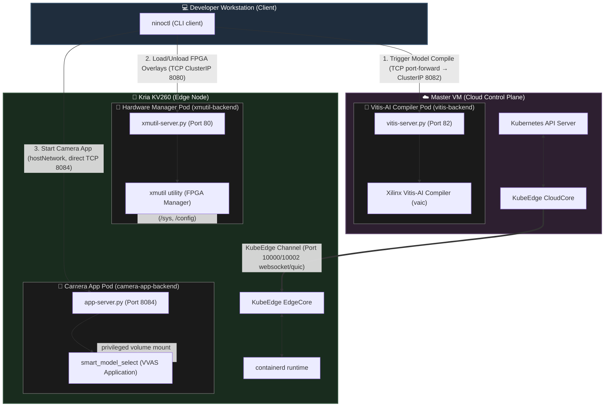

# Kubernetes & KubeEdge Network Architecture

This document describes the network topology and pod interaction model for the Ninox KV260 edge application orchestration system.

---

## 🗺️ System Architecture Diagram

The diagram below represents the logical nodes, pod placements, port bindings, and communications paths across the cluster:



---

## 🎛️ Node-by-Node Analysis

### 1. Master VM (Cloud)
- **Role**: Standard Kubernetes control plane and central registry.
- **KubeEdge Component**: Runs `cloudcore` which registers the edge node, syncs state changes (Device Twins), and routes edge traffic.
- **Where is Vitis-AI?**
  - **Vitis-AI runs exclusively on the Master VM** as a containerized pod (`vitis` deployment).
  - **Why?** Quantization, pruning, and compilation (converting deep learning frameworks like PyTorch/TensorFlow to `.xmodel` binaries) are computationally heavy processes that require high CPU/GPU resources. The resource-constrained Kria KV260 board is not suited for running compiler operations.
- **Service & Port**: Exposes `vitis-server.py` on container port `82`. The cluster exposes this through service `vitis-service` (ClusterIP, target port `8082`). Externally, this is routed via the Envoy Gateway (`HTTPRoute` at `vitis-ai.ninox.com`).
- **Envoy Ingress routing**: Fully integrated via Envoy Gateway. Access is configured via `HTTPRoute` resources mapped to `ninox-gateway` under the `*.ninox.com` wildcard domain.

### 2. Kria KV260 (Edge Node)
- **Role**: Target hardware device performing real-time inference and hardware overlay manipulation.
- **KubeEdge Component**: Runs `edgecore`, a lightweight agent replacing `kubelet`. It manages the container runtime (`containerd`) and subscribes to state updates from the master.
- **Active Pods Scheduled on the Edge**:
  - **`xmutil-app` Pod**:
    - **Purpose**: Exposes API endpoints to query, load, and unload FPGA bitstream overlays.
    - **Port Binding**: Port `80` inside container, mapped to service `xmutil-service` (Port `8080`), and routed via Envoy Gateway at `kv260-xmutil.ninox.com`.
    - **Privileged**: Requires `privileged: true` and direct volume mounts to the board's host filesystem (`/sys`, `/config`, `/tmp`, `/opt`) to enable the loading of FPGA overlays through the Linux kernel's FPGA Manager.
  - **`camera-app` Pod**:
    - **Purpose**: Exposes API endpoints to start, stop, and configure the GStreamer VVAS camera processing app.
    - **Port Binding**: Mapped using `hostNetwork: true` on port `8084` to allow direct, low-latency control.
    - **Privileged**: Runs as `privileged` to access host video capture files (`/dev/video*`), accelerators (`/dev/allegroIP`, `/dev/dri`), and Xilinx platform libs (`/opt/xilinx`).

### 3. Developer Workstation (Client CLI)
- **Role**: User interface initiating remote actions.
- **CLI Utility (`ninoctl`)**:
  - Connects to the Envoy Gateway routes or respective service ports to trigger workflows.
  - Sequential execution flow:
    1. Triggers model compilation on **Vitis-AI Pod** via `vitis-ai.ninox.com` (Master).
    2. Downloads compiled `.xmodel` files to the workstation.
    3. Transfers models and requests the **Xmutil Pod** via `kv260-xmutil.ninox.com` (Edge) to load the corresponding hardware bitstream overlay.
    4. Requests the **Camera App Pod** via port `8084` (Edge) to launch/restart the application with the newly compiled model target.

---

## Session 3 — End-to-End CLI Operationalization (2026-06-12)

### Goals
- Fix all TCP socket port mismatches across `vitis-server.py`, `xmutil-server.py`, and `app-server.py`.
- Switch all three deployments to `hostNetwork: true` so the CLI can connect directly to the node IPs without ClusterIP DNS.
- Build and validate the `ninoctl` CLI binary.
- Verify full end-to-end socket communication from the developer machine → sockets on master / KV260.

### 1. Port Alignment

The original server scripts bound to internal container ports (`82`, `80`, `31219`) that did not match what the Go CLI expected at the host level. The fix was:

| Service | Script | Old Port | New Port | Host |
|---------|--------|----------|----------|------|
| `vitis-server.py` | `/home/k8s/vitis-server.py` on master | 82 | **8082** | `192.168.123.210` (master) |
| `xmutil-server.py` | `/home/petalinux/xmutil-server.py` on KV260 | 80 | **8080** | `192.168.123.112` (zynqmp-generic) |
| `app-server.py` | `/opt/xilinx/kv260-vvas-sms/app/app-server.py` on KV260 | 31219 | **8084** | `192.168.123.112` (zynqmp-generic) |

### 2. `hostNetwork: true` for All Deployments

All three deployments (`vitis`, `xmutil-app`, `camera-app`) were updated to use `hostNetwork: true` in their pod specs so the socket servers bind directly to the node's IP. `strategy: Recreate` was also added to avoid host-port scheduling conflicts during rolling updates.

Files updated:
- `smartapp-modified/kv260-smartapp-clusterserver/deployment/vitis-ai.yaml`
- `smartapp-modified/kv260-smartapp-clusterserver/deployment/xmutil.yaml`
- `smartapp-modified/kv260-smartapp-clusterserver/deployment/app-pod.yaml`

### 3. `dfx-mgrd` Autostart in `xmutil-server.py`

`xmutil` commands (e.g., `listapps`, `loadapp`) require the FPGA DFX Manager daemon (`dfx-mgrd`) to be running. Since this daemon lives inside the container image but not on the Yocto host, `xmutil-server.py` was updated to auto-start it on launch:

```python
if not os.path.exists('/tmp/dfx-mgrd.socket'):
    subprocess.Popen(
        ['/usr/bin/dfx-mgrd'],
        stdout=open('/tmp/dfx-mgrd.log', 'w'),
        stderr=subprocess.STDOUT
    )
    import time; time.sleep(2)
```

The config file warning (`Cannot open /etc/dfx-mgrd/daemon.conf`) is non-fatal — the socket is still created and `xmutil` works.

### 4. CLI Config Centralization

The `ninoctl` Go CLI had all three service IPs hardcoded as `10.1.2.147` (a stale address). A new `config.go` was added to the `util` package:

```
smartapp-modified/kv260-smartapp-cli/src/util/config.go
```

All endpoints are now overridable via environment variables:
- `NINOCTL_XMUTIL_ADDR` (default: `192.168.123.112:8080`)
- `NINOCTL_VITIS_ADDR`  (default: `192.168.123.210:8082`)
- `NINOCTL_APP_ADDR`    (default: `192.168.123.112:8084`)

### 5. CLI Build

Built using a temporary Kubernetes Job running `golang:1.21` on the master node (no local Go installation required):

```bash
# Source was rsynced to /tmp/ninoctl-src on master, then:
kubectl apply -f - <<EOF
apiVersion: batch/v1
kind: Job
metadata:
  name: build-ninoctl
spec:
  template:
    spec:
      nodeSelector:
        kubernetes.io/hostname: master
      ...
      containers:
        - image: golang:1.21
          command: ["go", "build", "-o", "/output/ninoctl", "."]
EOF

# Copy binary back:
scp k8s@master.ninox.com:/tmp/ninoctl-output/ninoctl smartapp-modified/kv260-smartapp-cli/ninoctl
```

Binary is at: `smartapp-modified/kv260-smartapp-cli/ninoctl`

### 6. Verification Results

```bash
# List bitstreams (xmutil via socket to KV260:8080) — SUCCESS
$ ninoctl bitstream -list
This is the bitstream list
                     Accelerator          Accel_type  ...  Active_slot
# (empty — no bitstream loaded yet, which is expected)

# Configure app environment (app-server via socket to KV260:8084) — REACHED
$ ninoctl app -configure
This is configure env
/bin/sh: 1: source: not found
# (source is bash-only; the app-server runs commands via /bin/sh. Fixable by using '.' instead of 'source')
```

### 7. Known Remaining Issues

| Status | Issue | Impact | Fix |
|--------|-------|--------|-----|
| ✅ Fixed | `app -configure` uses `source` | Fails in `/bin/sh` on Yocto | Changed to `.` (dot) operator in `appcli.go`; rebuilt `ninoctl` |
| ✅ Fixed | No bitstreams loaded | No FPGA overlays active | Compiled `kv260-vvas-sms.dtbo` on host, added host mounts for `/lib/firmware` and `/usr/lib/libdfx.so.1.0` in `xmutil.yaml` |
| ✅ Fixed | `vitis-server.py` deploys model via `scp` to `petalinux@10.20.0.33` | Hardcoded KV260 management IP | Updated to `192.168.123.112` on master VM; vitis pod restarted |
