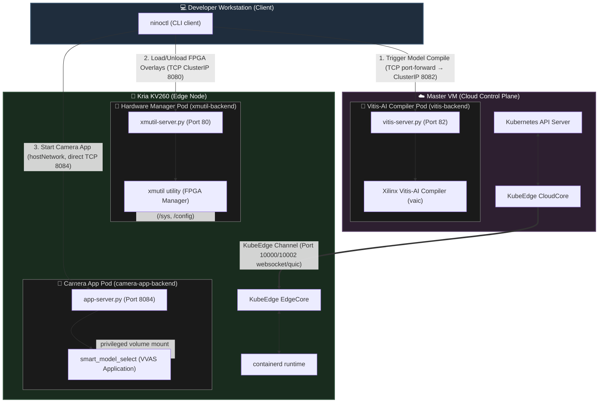

# Kubernetes & KubeEdge Network Architecture

This document describes the network topology and pod interaction model for the Ninox KV260 edge application orchestration system.

---

## 🗺️ System Architecture Diagram

The diagram below represents the logical nodes, pod placements, port bindings, and communications paths across the cluster:

---

## 🎛️ Node-by-Node Analysis

### 1. Master VM (Cloud)
- **Role**: Standard Kubernetes control plane and central registry.
- **KubeEdge Component**: Runs `cloudcore` which registers the edge node, syncs state changes (Device Twins), and routes edge traffic.
- **Where is Vitis-AI?**
  - **Vitis-AI runs exclusively on the Master VM** as a containerized pod (`vitis` deployment).
  - **Why?** Quantization, pruning, and compilation (converting deep learning frameworks like PyTorch/TensorFlow to `.xmodel` binaries) are computationally heavy processes that require high CPU/GPU resources. The resource-constrained Kria KV260 board is not suited for running compiler operations.
  - **Service & Port**: Exposes `vitis-server.py` on container port `82`. The cluster exposes this through service `vitis-service` (ClusterIP, target port `8082`). Access from outside the cluster requires `kubectl port-forward svc/vitis-service 8082:8082` or direct node IP access.
- **Nginx Ingress**: Not required for current deployment. The `nginx/` manifests are provided as an optional enhancement for hostname-based routing (`vitis.ai.ninox`, `kv260.xmutil.ninox`).

### 2. Kria KV260 (Edge Node)
- **Role**: Target hardware device performing real-time inference and hardware overlay manipulation.
- **KubeEdge Component**: Runs `edgecore`, a lightweight agent replacing `kubelet`. It manages the container runtime (`containerd`) and subscribes to state updates from the master.
- **Active Pods Scheduled on the Edge**:
  - **`xmutil-app` Pod**:
    - **Purpose**: Exposes API endpoints to query, load, and unload FPGA bitstream overlays.
    - **Port Binding**: Port `80` inside container, mapped to service `xmutil-service` (Port `8080`), and ingress `kv260.xmutil.ninox`.
    - **Privileged**: Requires `privileged: true` and direct volume mounts to the board's host filesystem (`/sys`, `/config`, `/tmp`, `/opt`) to enable the loading of FPGA overlays through the Linux kernel's FPGA Manager.
  - **`camera-app` Pod**:
    - **Purpose**: Exposes API endpoints to start, stop, and configure the GStreamer VVAS camera processing app.
    - **Port Binding**: Mapped using `hostNetwork: true` on port `8084` to allow direct, low-latency control.
    - **Privileged**: Runs as `privileged` to access host video capture files (`/dev/video*`), accelerators (`/dev/allegroIP`, `/dev/dri`), and Xilinx platform libs (`/opt/xilinx`).

### 3. Developer Workstation (Client CLI)
- **Role**: User interface initiating remote actions.
- **CLI Utility (`ninoctl`)**:
  - Connects to the Master node's ingress or the respective services to trigger workflows.
  - Sequential execution flow:
    1. Triggers model compilation on **Vitis-AI Pod** (Master).
    2. Downloads compiled `.xmodel` files to the workstation.
    3. Transfers models and requests the **Xmutil Pod** (Edge) to load the corresponding hardware bitstream overlay.
    4. Requests the **Camera App Pod** (Edge) to launch/restart the application with the newly compiled model target.
