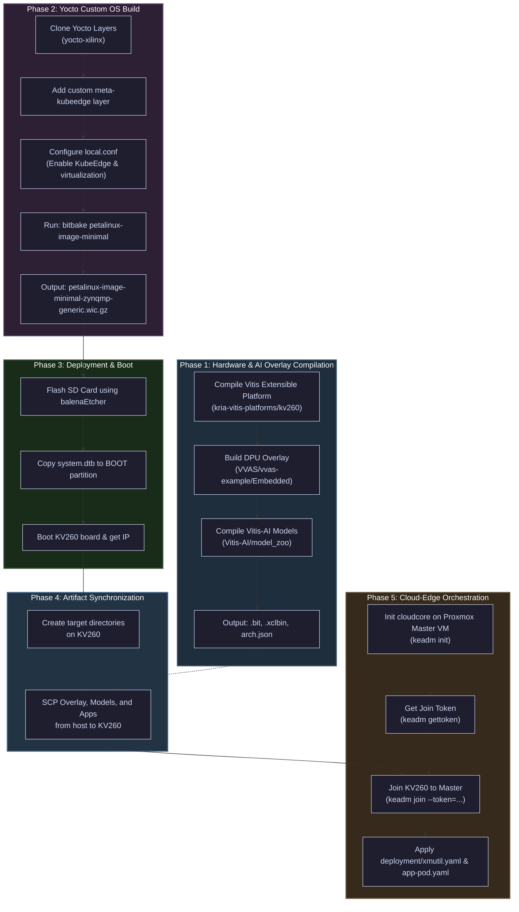
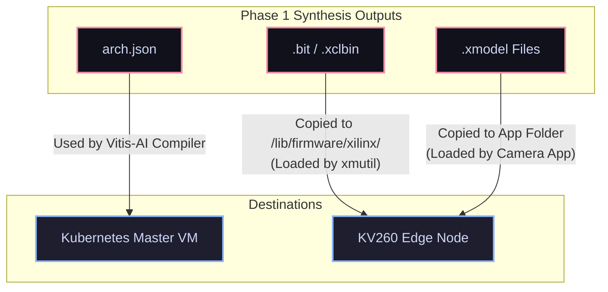

# Ninox Background Research Notes

## People

- **[ccchiang19](https://github.com/ccchiang19)**: Student in NYCU 2026
- **[JohnsonOUO](https://github.com/JohnsonOUO)**: Student in NYCU 2026
- **[Pm3-H](https://github.com/Pm3-H)**: 
- **[Appaul](https://github.com/Appaul)**:
- **[Ninox-Cyber](https://github.com/Ninox-Cyber)**:
- **[Ninox-Cybersecurity](https://github.com/Ninox-Cybersecurity)**:

---

## Repositories

### [ninox-cybersecurity.github.io](https://github.com/NinoX-Cybersecurity/ninox-cybersecurity.github.io)
- **Date**: May 5, 2021
- **Forked from**: [varadbhogayata.github.io](https://varadbhogayata.github.io/) (Original Author)
- **Preview**: [ninox-cybersecurity.github.io](https://ninox-cybersecurity.github.io/)
- **Contributors**:
  - [huangpen](https://github.com/huangpen)
  - NinoX-Cybersecurity
  - [varadbhogayata](https://github.com/varadbhogayata) (Original Author)

---

### [yocto-xilinx](https://github.com/n1n0x-MI4PLC/yocto-xilinx)
- **Date**: Feb 1, 2023
- **Summary**: Step-by-step guide for using the Yocto Project (Poky) to build a custom Linux image utilizing Xilinx layers for the Kria KV260 development board. It details the necessary meta-layer dependencies (such as `meta-xilinx`, `meta-petalinux`, and `meta-ros`), explains how to configure the build environment by modifying the `bblayer.conf` and `local.conf` files, and outlines the compilation process using the `bitbake` command. Furthermore, the repository provides two methods for packaging and flashing the resulting compiled image onto an SD card (using either Gparted for manual partitioning or balenaEtcher), and concludes with post-installation notes covering default credentials, network configuration, Proxmox access, and Talos Kubernetes deployment.
- **Contributors**:
  - [ccchiang19](https://github.com/ccchiang19)
  - NinoX-Cyber

---

### [kv260-smartplatform](https://github.com/n1n0x-MI4PLC/kv260-smartplatform)
- **Date**: Dec 1, 2022
- **Summary**: The `n1n0x-MI4PLC/kv260-smartplatform` repository serves as an end-to-end guide and codebase for deploying a hardware-accelerated, AI-powered smart camera application on the Xilinx Kria KV260 development board. It provides a complete workflow utilizing Vitis and PetaLinux (version 2022.1) to build a custom operating system equipped with edge machine learning capabilities.

#### Key Phases of the Workflow:
- **Environment & Platform Setup**: Detailed instructions for installing Vitis and PetaLinux, followed by building a custom Vitis Extensible Platform (`kv260_ispMipiRx_vcu_DP`).
- **Hardware Overlay & DPU Configuration**: Integrating the Vitis Video Analytics SDK (VVAS) to configure and compile the Deep Learning Processor Unit (DPU) overlay, generating the necessary bitstreams and `.xclbin` files.
- **OS Customization**: Using PetaLinux to create a custom Linux image based on an official Xilinx BSP. This includes injecting custom Yocto/BitBake recipes to handle firmware, network configurations, and application dependencies.
- **AI Model Compilation**: Leveraging a Vitis-AI Docker container to compile pre-trained models (specifically YOLOv3 and a face mask detection model) into formats compatible with the edge hardware.
- **Application Deployment**: Packaging the OS into a bootable SD card image and running a GStreamer-based application. The project concludes with instructions on using the `xmutil` utility to dynamically load the custom application and interact with a visual front-end interface to test the AI models.
- **Contributors**:
  - Appaul
  - [huangpen](https://github.com/huangpen)

---

### [smartapp-modified](https://github.com/n1n0x-MI4PLC/smartapp-modified)
- **Date**: Dec 1, 2022
- **Summary**: The `n1n0x-MI4PLC/smartapp-modified` repository builds upon previous Kria KV260 projects by introducing a socket-based client-server architecture managed via a K3s Kubernetes cluster. Its primary goal is to enable developers to remotely manage hardware configurations and deploy AI models to the KV260 edge device over a local network.

#### Key Architecture and Features:
- **Cluster Topology**: The K3s cluster consists of a Master Node (an Ubuntu VM hosted on Proxmox) and a Worker Node (the KV260 development board running PetaLinux).

- **Socket Servers**: The system distributes its workload across three Python-based socket servers:
  - **Vitis-AI Server**: Runs as a pod on the Master Node to handle heavy lifting, such as AI model quantization and compilation.
  - **Xmutil Server**: Runs as a pod on the KV260 to remotely load and unload hardware bitstreams.
  - **Application Server**: Runs directly on the KV260 (bare-metal) to execute the smart camera/model selection applications.
  
- **Command Line Interface (`ninoctl`)**: A custom, Docker-containerized CLI tool written in Go. This acts as the control hub, allowing users to issue remote commands to quantize, compile, and deploy models, swap bitstreams, or trigger edge applications directly from their laptop.

- **Contributors**:
  - [Pm3-H](https://github.com/Pm3-H)
  - [huangpen](https://github.com/huangpen)
  - [JohnsonOUO](https://github.com/JohnsonOUO)

#### Directory Structure and Submodule Analysis

Below is a detailed breakdown of the directories within the `smartapp-modified` workspace and their respective functions:

*   **[`kv260-smartapp-cli`](smartapp-modified/kv260-smartapp-cli/) (Go Command Line Interface)**
    *   **Purpose**: Contains the source code for the custom `ninoctl` command-line utility. 
    *   **Key Files**:
        *   `src/main.go`: Entry point for the CLI.
        *   `src/util/root.go`: Sets up the Cobra command structures.
        *   `src/util/tcpclient.go`: Handles standard TCP socket calls from `ninoctl` to the socket servers.
        *   `src/util/bitstreamcli.go`, `modelcli.go`, `appcli.go`: Commands to load bitstreams, quantize/compile models, and trigger applications on the board.
    
*   **[`kv260-smartapp-clusterserver`](smartapp-modified/kv260-smartapp-clusterserver/) (Cluster Service Logic & Manifests)**
    *   **Purpose**: Hosts the backend socket servers and the Kubernetes/KubeEdge orchestration manifests.
    *   **Key Subfolders**:
        *   [`server/`](smartapp-modified/kv260-smartapp-clusterserver/server/): Python socket servers (`app-server.py` to trigger edge execution, `xmutil-server.py` to load bitstreams, and `vitis-server.py` to handle remote compilation).
        *   [`deployment/`](smartapp-modified/kv260-smartapp-clusterserver/deployment/): K8s/KubeEdge manifest files (`xmutil.yaml` for hardware management, `app-pod.yaml` for Vitis-AI model execution, and `vitis-ai.yaml` for the compilation server).
        *   [`need/`](smartapp-modified/kv260-smartapp-clusterserver/need/): Reference model definitions and quantization weights (`resnet18_quant.py`, `model_best.pth`, `arch.json`) for DPU compilation testing.
        *   [`nginx/`](smartapp-modified/kv260-smartapp-clusterserver/nginx/): Ingress resources and manifests to configure edge ingress routing on the master.

*   **[`vitisImage`](smartapp-modified/vitisImage/) (Docker Build Helpers)**
    *   **Purpose**: Docker context files to build the host compilation environment container.
    *   **Key Files**: Contains a custom `ssh_config` that disables strict host key checking (`StrictHostKeyChecking no`), allowing automated SCP script file transfers from the master node to the KV260 edge node without prompting for trust confirmation.

*   **[`kv260-smartapp-platform`](smartapp-modified/kv260-smartapp-platform/) (Hardware & AI Overlay Submodules)**
    *   **Purpose**: An umbrella directory managing Git submodules for Xilinx physical overlays, platforms, and compilers.
    *   **Registered Submodules**:
        1.  **[`kria-vitis-platforms`](smartapp-modified/kv260-smartapp-platform/kria-vitis-platforms/)**: Contains Vivado hardware platform scripts to generate the baseline extensible hardware platform (`kv260_ispMipiRx_vcu_DP`), managing peripherals like cameras and displays.
        2.  **[`VVAS`](smartapp-modified/kv260-smartapp-platform/VVAS/) (Vitis Video Analytics SDK)**: Provides GStreamer acceleration plugins to wrap physical overlays into GStreamer media pipelines.
        3.  **[`Vitis-AI`](smartapp-modified/kv260-smartapp-platform/Vitis-AI/)**: The AMD/Xilinx deep learning runtime, compiler, and Model Zoo. Used to quantize and target PyTorch/TensorFlow networks to the target DPU overlay.
        4.  **[`kria-apps-firmware`](smartapp-modified/kv260-smartapp-platform/kria-apps-firmware/)**: The reference firmware overlays and bitstreams release directory for Kria starter kit applications.
    *   **Key Subfolders**:
        *   [`change/`](smartapp-modified/kv260-smartapp-platform/change/): Custom overlay settings, modifications to the baseline VVAS model select app, and PetaLinux image configurations.

---

### [kv260-smartapp-auto](https://github.com/n1n0x-MI4PLC/kv260-smartapp-auto)
- **Date**: Dec 16, 2022
- **Summary**: This repository appears to be a direct iteration, fork, or mirror of the previously mentioned `smartapp-modified` project, as the documentation and architectural goals are essentially identical. Like its counterpart, this repository details the setup of a K3s Kubernetes client-server architecture designed to remotely manage and deploy AI models to a Kria KV260 development board.

#### Key components include:
- **Cluster Environment**: A Proxmox Ubuntu VM acting as the Master node, and the KV260 acting as the Worker node.
- **Socket Servers (Python)**: Three distinct servers handle remote requests: one for Vitis-AI (quantization/compilation on the VM), one for `xmutil` (bitstream loading on the KV260), and one for executing the smart camera application on the board.
- **Remote Management CLI**: A Dockerized, Go-based command-line tool (`ninoctl`) that allows users to seamlessly trigger bitstream updates, compile models, and launch edge applications over the local network without needing to directly interface with the board.
- **Contributors**:
  - [JohnsonOUO](https://github.com/JohnsonOUO)
  - [ccchiang19](https://github.com/ccchiang19)

---

## Logical Progression for Review

1. **[yocto-xilinx](#yocto-xilinx) (The Foundation)**
   - **What it is**: The lowest-level system configuration.
   - **Why start here**: This repo establishes the base Linux environment using the Yocto Project (Poky) and pulls in the necessary hardware-specific Xilinx meta-layers. Before deploying AI models or server architectures, you need to understand how the base OS is constructed, how layers are added via `bblayer.conf`, and how the SD card is partitioned to even get the KV260 board to boot properly.

2. **[kv260-smartplatform](#kv260-smartplatform) (The Hardware & Application Layer)**
   - **What it is**: The core edge AI implementation.
   - **Why read it second**: Once you understand the base OS, this repo shows you how to build the actual "smart" capabilities on top of it. It walks through creating the Vitis hardware platform, compiling the DPU (Deep Learning Processor Unit) overlay, and using PetaLinux to integrate custom AI models (like YOLOv3) and the VVAS smart camera application. This is where the primary functionality of the edge device lives.

3. **[smartapp-modified](#smartapp-modified) & [kv260-smartapp-auto](#kv260-smartapp-auto) (The Orchestration Layer)**
   - **What they are**: Remote management and cluster networking.
   - **Why read them last**: These repos (which are functionally identical based on the readmes) act as a wrapper around the work done in step 2. They assume the smart camera application already exists. Going through these last will show you how to take a standalone edge device and turn it into a manageable node within a K3s Kubernetes cluster, allowing you to remotely update bitstreams, swap AI models, and trigger applications using a custom CLI.

---

## Alternative Orchestration: KubeEdge vs. K3s

To ensure native compatibility with standard Kubernetes (K8s) clusters while optimizing edge resource utilization, **KubeEdge** is a strong alternative/upgrade to the existing **K3s** setup.

### Comparison Matrix

| Feature | K3s Agent (Current Setup) | KubeEdge (`edgecore`) |
| :--- | :--- | :--- |
| **Control Plane Model** | Distributed. K3s runs full agent workloads on the worker node. | Split. Master VM runs `cloudcore`; KV260 runs lightweight `edgecore` daemon. |
| **Resource Footprint** | Moderate (~50-100MB RAM, higher CPU overhead). | Minimal (~15-30MB RAM, optimized CPU footprint). |
| **Network Resilience** | Low. Expects low-latency, bidirectional LAN connectivity. | High. Built-in local persistence (SQLite) for offline autonomy. |
| **NAT / Firewall Traversal** | Requires custom DNAT/port forwarding on Master. | Outbound WebSocket/QUIC tunnel from Edge. Works behind standard NAT/routers. |
| **Device Integration** | Standard pods / Host commands. | Native **Device Twins** and Custom Resource Definitions (CRDs). |

### Key Implementation Considerations for KV260

1. **Pod Hardware Access**:
   The Vitis-AI camera application requires privileged access to host hardware overlays (e.g. `/dev/dri/*`, `/dev/xclbin*`, `/dev/video*`). Running these workloads in pods (under K3s or KubeEdge) requires configuring the Pod security context with `privileged: true` and mounting the host `/dev` paths:
   ```yaml
   securityContext:
     privileged: true
   volumeMounts:
   - mountPath: /dev
     name: dev-dir
   ```

2. **Integration with Yocto Build**:
   The current PetaLinux image configuration has the virtualization layer enabled (`DISTRO_FEATURES:append = " virtualization"` in `local.conf`). KubeEdge's `edgecore` can be compiled for ARM64 and integrated into the image to interface directly with the local `containerd` container runtime.

---

## KubeEdge Migration Repository Roles & Redundancy

During the KubeEdge migration phase, the roles, changes, and redundancies of the active repositories were analyzed:

### 1. `smartapp-modified/kv260-smartapp-platform` (Relocated from `kv260-smartplatform`)
* **Status**: Relocated as a Git submodule inside `smartapp-modified`.
* **Role**: Baseline hardware reference.
* **Reasoning**: This repository contains the Vitis video analytics overlay components (`VVAS`), DPU configurations, and legacy PetaLinux 2022.1 configurations. It has been integrated directly into the `smartapp-modified` repository as a Git submodule under `kv260-smartapp-platform` for centralized management. Since KubeEdge is a software-level orchestration transition, the physical FPGA bitstream synthesis (Vivado/Vitis flow) and Vitis-AI model compilation steps are unaffected and remain identical. The OS building phase has been replaced by the newer Yocto Scarthgap project (`yocto-xilinx`).

### 2. `smartapp-modified` vs. `kv260-smartapp-auto` (Active vs. Template)
* **Status**: Conceptually redundant, but `smartapp-modified` is the active development path.
* **Reasoning**: Both folders contain the same socket/CLI client-server architecture. However, they track different remote repositories. 
  * **`smartapp-modified`** contains actual developer customizations, including:
    * Environment-specific fixes (e.g., host paths pointing to `/home/gary/` and Docker image references for `pm3h/x-vitis-ai:2.5.4`).
    * An updated CLI tool `ninoctl` (Go) that supports two-argument model deployments (`DeployModel(string, string)` to specify both directory name and model name).
    * Python script fixes (e.g., shell command execution wrappers in `vitis-server.py`).
    * Development helpers like `vitisImage` Docker contexts and `testlines.md`.
  * **`kv260-smartapp-auto`** acts as the clean template repository using placeholders (e.g., `<PATH-TO-VITIS-AI>`).
* **Direction**: Treat `smartapp-modified` as the primary workspace repository for new features and deployment setups, and keep `kv260-smartapp-auto` as the generic upstream baseline.

### 3. Toolchain & Host OS Versioning Compatibility Warning
> [!WARNING]
> **Do not attempt to install Vitis 2022.1 or PetaLinux 2022.1 natively on Ubuntu 24.04.**
> Compiling legacy toolchains (2022.1) natively on Ubuntu 24.04 will fail due to incompatible host library versions (e.g. `glibc`, `gcc`, and core shell utilities).
> To run the hardware build workflows:
> 1. **Vitis-AI Model Compiler**: Always use the containerized compiler (`xilinx/vitis-ai:2.5` Docker image).
> 2. **Vitis Platform Synthesis**: Set up a containerized environment (such as **Distrobox** or **Docker**) running **Ubuntu 20.04** to run Vivado/Vitis platform and DPU synthesis.

---


## Step-by-Step KubeEdge Build, Deployment, and Communication Walkthrough

This section provides the end-to-end workflow to compile the custom OS, prepare the FPGA AI overlays, flash the board, and establish secure Cloud-Edge orchestration via KubeEdge.

### Workflow Architecture Diagram



### Detailed Implementation Phases

> [!TIP]
> For a visual overview of the KubeEdge cluster architecture, node interactions, and network ports used by our Go CLI and backend services, refer to the [Kubernetes & KubeEdge Network Architecture Guide](k8s_network_architecture.md).

#### Phase 1: Hardware & AI Overlay Preparation (`smartapp-modified/kv260-smartapp-platform`)
> [!NOTE]
> Vitis/Vivado 2022.1 requires an Ubuntu 20.04 environment. If your host is Ubuntu 24.04, you must build the platform inside an Ubuntu 20.04 container mapping your host's Xilinx tools. 
> For detailed instructions on downloading, preparing host directories, installing dependencies, and running the graphical installer container, refer to the [Vitis Installation Guide](smartapp-modified/vitis_installation_guide.md).

> [!NOTE]

1. **Initialize and Update Submodules**:
   ```bash
   cd smartapp-modified/kv260-smartapp-platform
   git submodule update --init --recursive --progress -j 8
   ```

2. **Launch the Vitis Build Container (Ubuntu 20.04)**:
   Launch a Docker container that maps your workspace and your host's Xilinx installation directory (e.g. `/tools/Xilinx` or `/opt/Xilinx`):
   ```bash
    docker run -it \
      --name vitis-builder \
      --net=host \
      -e TERM=xterm-256color \
      -v $(pwd):$(pwd) \
      -v ~/Xilinx:/tools/Xilinx \
      -v /opt/Xilinx:/opt/Xilinx \
      ubuntu:20.04 bash
   ```
   *Inside the container, install the basic required build tools, enable colored shell output, and source the Xilinx settings:*
   ```bash
      # Enable colored terminal prompt
      sed -i 's/#force_color_prompt=yes/force_color_prompt=yes/' ~/.bashrc
      source ~/.bashrc

      # Install build tools, required Vivado libraries, and locales (required to prevent Vivado locale crash)
      apt-get update && apt-get install -y build-essential git make locales libtinfo5 libncurses5 x11-utils xvfb dbus-x11 libgtk-3-0 unzip
      locale-gen en_US.UTF-8
      export LANG=en_US.UTF-8
      export LC_ALL=en_US.UTF-8

      # Source the Vitis environment setup script
      source /tools/Xilinx/Vitis/2022.1/settings64.sh
   ```

3. **Build the Platform**:
   Navigate to the platform directory [kria-vitis-platforms/kv260](smartapp-modified/kv260-smartapp-platform/kria-vitis-platforms/kv260) inside the container and build:
   ```bash
      cd smartapp-modified/kv260-smartapp-platform/kria-vitis-platforms/kv260
      make platform PFM=kv260_ispMipiRx_vcu_DP
   ```

4. **Build the DPU Overlay**:
   Return to the root of the platform folder inside the container:
   ```bash
      cd smartapp-modified/kv260-smartapp-platform
   ```
   Extract `DPUCZDX8G.tar.gz` into `Vitis-AI/dsa`. Apply the VVAS custom configurations:
   ```bash
      mkdir -p Vitis-AI/dsa && tar -xzf DPUCZDX8G.tar.gz -C Vitis-AI/dsa/
      cp change/vvas-overlay/* VVAS/vvas-examples/Embedded/smart_model_select/
      cd VVAS/vvas-examples/Embedded/smart_model_select
      source build.sh
   ```
    This outputs the FPGA binary `.bit`, accelerator configuration `.xclbin`, and DPU metadata `arch.json`.

    > [!IMPORTANT]
    > **Device Tree Overlay (DTSI) Correction:**
    > Before packaging, the `firmware-name` property inside the device tree overlay source file `kv260-vvas-sms.dtsi` must be updated to `"kv260-vvas-sms.bit.bin"` (instead of the baseline `"kv260-smartcam.bit.bin"`). This ensures the Linux kernel's FPGA Manager looks for the correct raw bitstream file in the target firmware directory when programmed.

5. **Compile Model Zoo**:
   Start the Vitis-AI Docker container (from your host system or containerized environment) and compile the models (YOLOv3 / Face Mask Detection) targeting the built DPU architecture:

   > [!TIP]
   > Running with `sudo` will cause generated files inside the volume to be owned by `root`. To run Docker commands without `sudo` (which lets `docker_run.sh` run under your own UID/GID):
   > 1. Add your user to the `docker` group:
   >    ```bash
   >    sudo usermod -aG docker $USER
   >    ```
   > 2. Restart your shell session (or log out and log back in) for the group change to take effect.
   > 3. Run the script directly without `sudo`:
   >    ```bash
   >    ./docker_run.sh xilinx/vitis-ai:2.5
   >    ```

   Navigate to the directory, launch the container (with or without `sudo` depending on the setup above), and compile the models:
   ```bash
   cd smartapp-modified/kv260-smartapp-platform/Vitis-AI
   # Run without sudo (if configured above) or prefix with sudo
   ./docker_run.sh xilinx/vitis-ai:2.5

   # Inside the container:
   cd model_zoo
   source ./compile_modelzoo.sh
   ```

6. **Stage and Synchronize Recipes (Legacy / Archival)**:
   > [!NOTE]
   > This step stages files into the legacy application directory for archiving purposes or for the older PetaLinux build flow. Because our modern Yocto build (`yocto-xilinx/kv260-yocto`) compiles a clean base OS image, these staged files are **not** baked into the Yocto image by default. Instead, they will be copied directly to the SD card's `ROOTFS` partition (or sent via SSH) during the **Artifact Synchronization** phase.
   
   To archive the files, navigate to the application platform directory:
   ```bash
   cd smartapp-modified/kv260-smartapp-platform
   ```
   * **Staging Hardware Overlay**:
     Copy the synthesized `.bit` and `.xclbin` files, along with the device tree overlay configurations:
     ```bash
     cp VVAS/vvas-examples/Embedded/smart_model_select/binary_container_1/sd_card/kv260_ispMipiRx_vcu_DP_wrapper.bit change/petalinux_new/meta-user/recipes-apps/kv260-vvas-sms/files/kv260-vvas-sms.bit
     cp VVAS/vvas-examples/Embedded/smart_model_select/binary_container_1/sd_card/dpu.xclbin change/petalinux_new/meta-user/recipes-apps/kv260-vvas-sms/files/kv260-vvas-sms.xclbin
     cp kria-apps-firmware/boards/kv260/smartcam/kv260-smartcam.dtsi change/petalinux_new/meta-user/recipes-apps/kv260-vvas-sms/files/kv260-vvas-sms.dtsi
     cp kria-apps-firmware/boards/kv260/smartcam/shell.json change/petalinux_new/meta-user/recipes-apps/kv260-vvas-sms/files/shell.json
     ```
   * **Staging Compiled AI Models**:
     Copy the custom labels into the compiled model output directories and copy the entire `models.b3136` bundle to the recipe folder:
     ```bash
     cp change/model_gen/yolov3_label.json Vitis-AI/model_zoo/models.b3136/yolov3_voc_tf/label.json
     cp change/model_gen/face_mask_label.json Vitis-AI/model_zoo/models.b3136/face_mask_detection_pt/label.json
     cp -r Vitis-AI/model_zoo/models.b3136 change/petalinux_new/meta-user/recipes-apps/kv260-vvas-sms-models/files/
     ```
   * **Staging VVAS Application**:
     Copy the custom application files into the recipe files:
     ```bash
     cp -r change/app/* change/petalinux_new/meta-user/recipes-apps/kv260-vvas-sms-app/files/
     ```


#### Phase 2: Custom Linux Image Building (`yocto-xilinx`)
*Note: Due to library compatibility issues on Ubuntu 24.04 hosts, you must run this compilation inside the custom Ubuntu 24.04 builder container. For complete configuration details, refer to the [yocto-xilinx/readme.md](yocto-xilinx/readme.md) file.*

1. **Build the Docker Image**:
   From your workspace directory on the host:
   ```bash
   cd kv260-workspace
   docker build -t kv260-build-env:24.04 .
   ```

2. **Run the Builder Container**:
   Launch the container, ensuring the workspace is mapped to the exact same path to prevent absolute path issues with BitBake/sstate-cache:
   ```bash
   docker run -it \
     --name kv260-yocto-env \
     --net host \
     --security-opt seccomp=unconfined \
     -v $(pwd):$(pwd) \
     kv260-build-env:24.04 /bin/bash
   ```
   *(Note: The `--security-opt seccomp=unconfined` option is critical to allow `pseudo` / fakeroot during bitbake.)*

3. **Initialize Poky & Clone Layers**:
   Clone the reference `poky` repository along with all target meta-layers (`meta-xilinx`, `meta-petalinux`, `meta-ros`, `meta-virtualization`).

4. **Inject custom `meta-kubeedge`**:
   Create a new layer folder `source/meta-kubeedge` containing the recipe for compiling and packaging the pre-built `edgecore` and `keadm` binaries.

5. **Configure Layers (`conf/bblayers.conf`)**:
   Add the path to `meta-kubeedge` in your `BBLAYERS` list.

6. **Enable Virtualization & KubeEdge (`conf/local.conf`)**:
   Open `conf/local.conf` and append:
   ```bitbake
    DISTRO_FEATURES:append = " virtualization"
    IMAGE_INSTALL:append = " kubeedge containerd-opencontainers"
   ```

7. **Run the Compilation**:
   Disable unprivileged namespace restrictions on the Ubuntu 24.04 build host, then compile:
   ```bash
   sudo sysctl -w kernel.apparmor_restrict_unprivileged_userns=0
   cd poky
   source oe-init-build-env
   bitbake petalinux-image-minimal
   ```

#### Phase 3: Deployment & Booting the KV260
1. **Flash OS**:
   Insert the SD card, open **balenaEtcher**, and flash the compiled image output:
   `poky/build/tmp/deploy/images/zynqmp-generic/petalinux-image-minimal-zynqmp-generic.wic.gz`
2. **Copy Boot Assets**:
   * Mount the `BOOT` partition of the SD card on your computer and copy/replace the repo's `system.dtb` file to the `BOOT` partition of the SD card.
3. **Power Up & Initial Config**:
   * Insert the SD card into the KV260.
   * Connect a micro-USB cable from the host machine to the micro-USB UART port (`J4`, located on the bottom edge near the SD card slot).
   * Programmed over a single cable, the board exposes four `ttyUSB` channels on the host (typically `ttyUSB0` through `ttyUSB3`). You will connect to the **Processing System (PS) UART** channel (typically `/dev/ttyUSB1`):
     ```bash
     ls /dev/ttyUSB*
     # Expected output: /dev/ttyUSB0  /dev/ttyUSB1  /dev/ttyUSB2  /dev/ttyUSB3

     sudo screen /dev/ttyUSB1 115200
     ```
     *(Note: If the terminal stays blank after hitting `Enter` a few times, kill the session using `Ctrl+A` then `K` and try the adjacent port `/dev/ttyUSB0` or `/dev/ttyUSB2` depending on how your host enumerates the USB stack.)*
   * Power on the board by plugging in the 12V power adapter.
   * Hit `Enter` on your screen session terminal to wake up the prompt and log in using `root` / `nino123x`.
   * Ensure the board has a valid IP address and network access (e.g. by running `ip a show eth0` to find `<kv260-ip-address>`).

---

#### Phase 4: Artifact Synchronization

Once the board has booted and is connected to the network, you must synchronize and transfer the build artifacts to their appropriate destinations before initiating KubeEdge communication.

##### Artifact Distribution Flowchart


##### Detailed Transfer Steps

> [!TIP]
> **SSH Server is Pre-configured**: The compiled Yocto image automatically packages `openssh` and enables `debug-tweaks`. This means an SSH daemon will run out-of-the-box upon boot, allowing passwordless login for the `root` user.

Once the board is booted and connected to the network, use SSH/SCP to transfer your custom hardware overlay, models, and application files:

1. **Deploy DPU Hardware Overlay on KV260 (`.bit`, `.xclbin`)**:
   * Create the application firmware folder on the target node:
     ```bash
     ssh root@<kv260-ip-address> "mkdir -p /lib/firmware/xilinx/kv260-vvas-sms"
     ```
   * Secure copy (SCP) the synthesized overlay files to the node:
     ```bash
     scp smartapp-modified/kv260-smartapp-platform/change/petalinux_new/meta-user/recipes-apps/kv260-vvas-sms/files/* root@<kv260-ip-address>:/lib/firmware/xilinx/kv260-vvas-sms/
     ```
   * These files will be loaded dynamically by `xmutil` during Phase 5.

2. **Deploy Compiled Models & App Files on KV260**:
   * Create the application directory on the target node:
     ```bash
     ssh root@<kv260-ip-address> "mkdir -p /opt/xilinx/kv260-vvas-sms/app/"
     ```
   * Secure copy (SCP) the application source scripts:
     ```bash
     scp -r smartapp-modified/kv260-smartapp-platform/change/petalinux_new/meta-user/recipes-apps/kv260-vvas-sms-app/files/* root@<kv260-ip-address>:/opt/xilinx/kv260-vvas-sms/app/
     ```
   * Secure copy (SCP) the compiled models (copies the `models.b3136` folder):
     ```bash
     scp -r smartapp-modified/kv260-smartapp-platform/change/petalinux_new/meta-user/recipes-apps/kv260-vvas-sms-models/files/* root@<kv260-ip-address>:/opt/xilinx/kv260-vvas-sms/
     ```

##### 🖥️ Master VM Deployment

* **Deploy DPU Architecture File on Master VM (`arch.json`)**:
  * Copy the generated `arch.json` file from your Vitis synthesis host to your Kubernetes Master VM.
  * Place it in the directory where the Vitis-AI compiler is run, so that `vai_c` compiled model versions align with your physical DPU logic configuration.

---

#### Phase 5: Setting up KubeEdge Communication & Pod Deployment

*For a complete network layout, port binding lists, and pod-to-node mapping descriptions, refer to the [Kubernetes & KubeEdge Network Architecture Guide](k8s_network_architecture.md).*

##### 5.1: Cloud-Edge Cluster Connection
1. **Initialize CloudCore (on Master VM)**:
   Ensure Kubernetes is running on your Master Node (e.g. Proxmox VM). Run `keadm init` to download and launch the KubeEdge control plane (`cloudcore`):
   ```bash
   keadm init --advertise-address=<MASTER-IP> --profile-version=1.15.0
   ```
2. **Retrieve Node Join Token (on Master VM)**:
   ```bash
   keadm gettoken
   ```
3. **Join Edge Node (on KV260)**:
   Run `keadm join` on the KV260 to connect the board as a managed KubeEdge node:
   ```bash
   keadm join --cloudcore-ipport=<MASTER-IP>:10000 --token=<TOKEN> --kubeedge-version=1.15.0
   ```
4. **Label the Edge Node (on Master VM/Laptop)**:
   Label the newly joined KV260 node so that targeted KubeEdge workloads are correctly scheduled on it:
   ```bash
   kubectl label node <kv260-node-name> node-role.kubernetes.io/edge=""
   ```
5. **Deploy the Ingress Controller (on Master VM/Laptop)**:
   Set up edge ingress routing on the master:
   ```bash
   kubectl apply -k kv260-smartapp-clusterserver/nginx
   ```

##### 5.2: Staging Server Scripts and Host Directory Setup
Before deploying the pods, we must copy the backend socket server scripts to their target destinations and prepare the environment directories.

- **On the Master VM (vitis-ai compiler backend)**:
  Copy dependencies and compilation helpers to the Master VM:
  ```bash
  # Copy dependencies onto the Master VM
  scp -r kv260-smartapp-clusterserver/need <vm-node>:~/

  # On the Master VM:
  # Copy arch.json, custom configs, and datasets into Vitis-AI folder
  cp need/arch.json <path-to-Vitis-AI>/
  cp need/my_model.prototxt <path-to-Vitis-AI>/
  cp -r need/ALLFORDEMO <path-to-Vitis-AI>/
  cp need/resnet18_quant.py <path-to-Vitis-AI>/src/Vitis-AI-Quantizer/vai_q_pytorch/example/
  cp server/vitis-server.py <path-to-Vitis-AI>/

  # Create necessary host volumes for Vitis-AI pod deployment
  mkdir -p /dev/shm
  mkdir -p /opt/xilinx/overlaybins
  mkdir -p /opt/xilinx/dsa
  ```
- **On the KV260 Edge Node (xmutil & camera app backends)**:
  Copy the socket server scripts directly to the KV260 filesystem:
  ```bash
  # Copy the xmutil-server.py script
  scp server/xmutil-server.py <kv260-node>:/home/petalinux/

  # Copy the app-server.py script
  scp server/app-server.py <kv260-node>:/opt/xilinx/kv260-vvas-sms/app/
  ```

##### 5.3: Deploying Orchestrated Workloads (on Master VM/Laptop)
Deploy the compiler, hardware overlay manager, and camera application pods to the cluster:
```bash
# Deploy Vitis AI compiler pod (on master)
kubectl apply -f kv260-smartapp-clusterserver/deployment/vitis-ai.yaml

# Deploy xmutil hardware manager pod (on KV260)
kubectl apply -f kv260-smartapp-clusterserver/deployment/xmutil.yaml

# Deploy camera application pod (on KV260)
kubectl apply -f kv260-smartapp-clusterserver/deployment/app-pod.yaml
```
*(Ensure these pods run as `privileged: true` with `/sys`, `/config`, and `/dev` mounted to allow direct hardware interaction with the DPU and overlays).*

##### 5.4: Command Line Interface (`ninoctl`) and Remote Execution
Build and run the `ninoctl` client inside its container to trigger remote quantization, compilation, and deployment commands:
```bash
cd kv260-smartapp-cli
docker build --target prod . -t ninoctl
docker run -it ninoctl
```
Refer to [`testlines.md`](smartapp-modified/testlines.md) for pre-defined test command arguments for quantization, compilation, and deployment.

##### 5.5: Native State Orchestration via Device Twins (Alternative/Upgrade)
Instead of executing commands manually via sockets and the Go CLI, KubeEdge supports native, declarative hardware management using Device Twins (CRDs) over MQTT.
Refer to the [`kubeedge_integration_guide.md`](smartapp-modified/kubeedge_integration_guide.md) for instructions on defining `DeviceModel`/`DeviceInstance` custom resources, launching the Python MQTT mapper on the board to program the FPGA overlays, and patching twin states natively using `kubectl patch`.